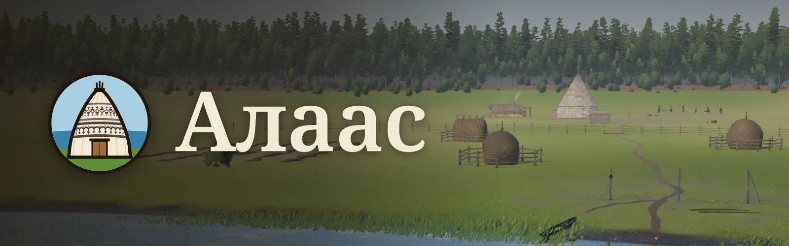
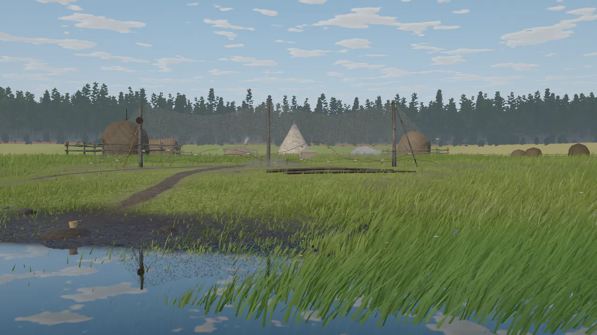
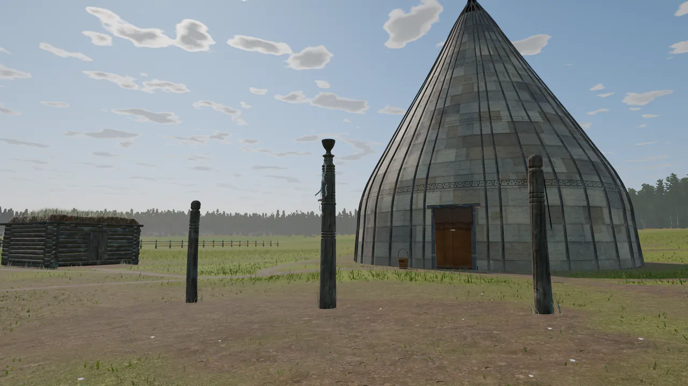
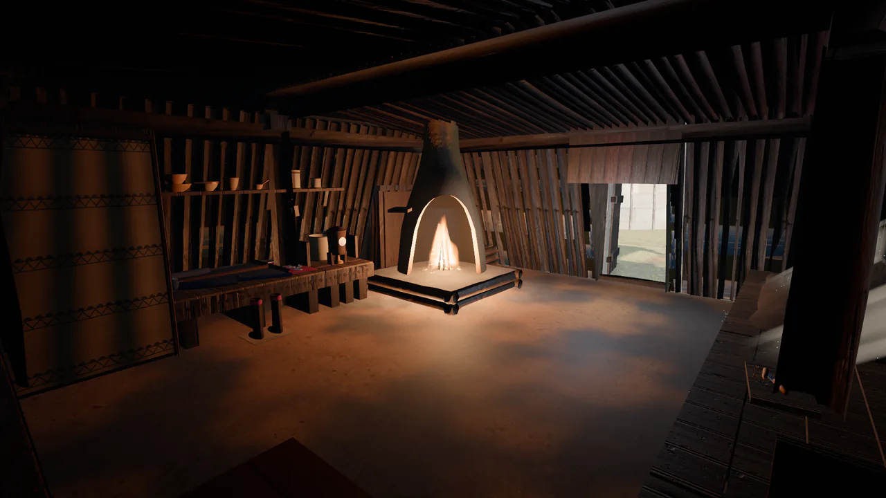
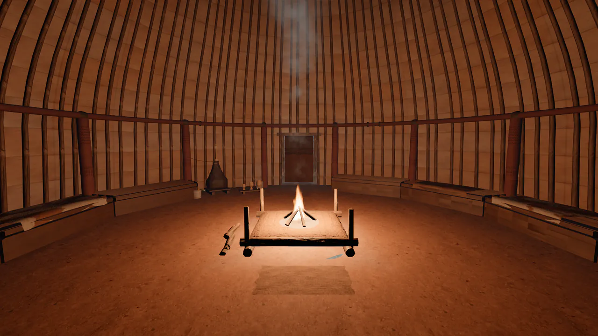
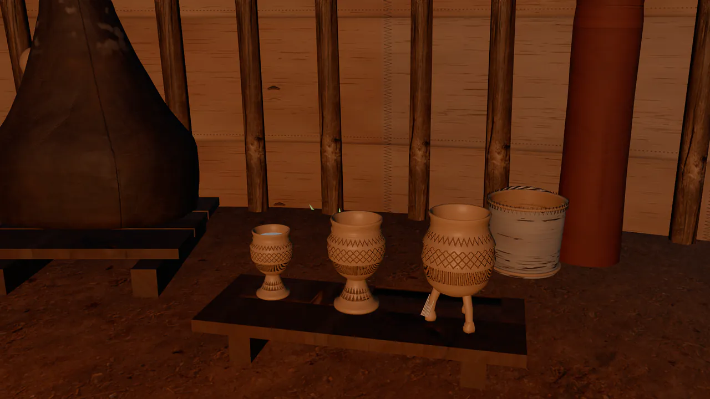
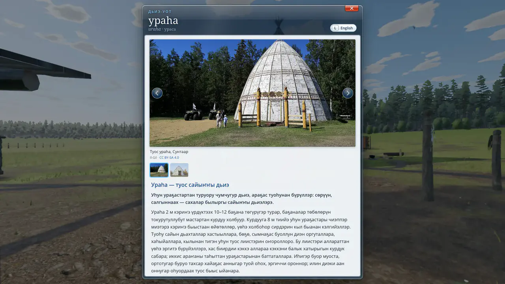

<p align="center">
  
</p>

<p align="center">
  <b>Киин Саха сирин алааһыгар сайылык</b><br>
  A summer homestead in Central Yakutia — a first-person walk through Sakha culture.
</p>

<p align="center">
  
  
  
  
  
  
  
</p>

<p align="center">
  <a href="#quick-start"><b>Play locally</b></a> · <a href="CONTRIBUTING.md"><b>Contributing</b></a> · <a href="docs/credits.md"><b>Credits</b></a>
</p>

Алаас is a first-person walk through a traditional Sakha summer homestead (сайылык) in an alaas, the
round meadow-and-lake hollow in the taiga where Sakha families have kept horses and cattle for centuries.
It is told from the Sakha point of view: the birch-bark urasa, the balagan with its hearth, the serge
hitching posts, the kymys and the fire's spirit are shown as a living culture, in its own words — Sakha
first, then English and Russian, picked from your browser's language. There is no combat and no score. You walk, look and learn.

<table>
  <tr>
    <td width="33%" align="center"><br><sub>Down at the lake, the path climbs to the сайылык</sub></td>
    <td width="33%" align="center"><br><sub>Serge hitching posts before the urasa</sub></td>
    <td width="33%" align="center"><br><sub>The balagan, lit by its оһох hearth</sub></td>
  </tr>
  <tr>
    <td width="33%" align="center"><br><sub>Inside the urasa: the fire, the benches, the bark cover</sub></td>
    <td width="33%" align="center"><br><sub>Carved чороон cups for kymys</sub></td>
    <td width="33%" align="center"><br><sub>Explainer cards: Sakha first, then English, Russian</sub></td>
  </tr>
</table>

## Features
- **51 explainer cards** in Sakha, English and Russian, with sources and 72 reference images. Look at a
  thing, press E for a short note, E again for the full read; the journal collects what you have found and hints at where the rest are.
- **Hands-on acts** done with respect: feed the fire, tie a ribbon on the serge, carry water, lay
  firewood, sit on the орон, pick дьэдьэн. Sacred rites are explained, never played.
- **A living alaas**: procedural larch, birch and pine taiga, wind in the grass, birds, insects, a lake
  with reflections, a physical sky with drifting cloud shadows, and real field recordings.
- **Runs in the browser**: three.js WebGPURenderer with TSL shaders, steady 60 fps, no backend, no
  account. Progress stays in your browser.

## Browser support
| | |
|---|---|
| Chrome, Edge (desktop) | WebGPU |
| Safari (macOS, iOS) | WebGPU |
| Phones | touch controls, a lighter `mobile` tier, 30 fps battery saver |
| Anything without WebGPU | WebGL2 fallback (force it with `?webgl`) |

The quality tier is picked from the device (Settings → Quality changes it).

## Quick start
```sh
npm install
npm run dev        # http://127.0.0.1:5190
npm run build      # static site in dist/
```
Node 20.19+ or 22.12+. The textures, audio and images are in the repository; no download step is needed.

## Controls
| Key | Action |
|---|---|
| W A S D · mouse | walk · look |
| Shift · Space · C | run · jump / vault · crouch |
| E | look closer / do |
| 1 2 3 | choose |
| J · L · H | journal · language · controls |
| P · F3 | pause and settings (keeps the mouse) · frame-rate meter |
| Esc | pause (releases the mouse) |

Phones: left thumb walks (push to the rim to run), right thumb looks, a tap is E.

## Project structure
| Path | What |
|---|---|
| `src/main.js` | boot, loading, the frame loop and the E flow |
| `src/engine/` | renderer, sky, sun, post-processing, device tiers, draw-call merging |
| `src/world/` | terrain, ground and `layout.js`, where everything stands |
| `src/models/` | one module per building or yard piece |
| `src/nature/` | forest, grass, lake and wildlife |
| `src/interact/` · `src/ui/` · `src/audio/` | hands-on acts · cards, journal, touch · soundscape |
| `src/data/` | explainer entries and reference images |
| `tools/` | asset fetchers, texture bakers and headless checks |
| `docs/` | how it all works ([`AGENTS.md`](AGENTS.md) has the map) |

## Contributing
Contributions are welcome, from code to Sakha-language corrections. Read
[`CONTRIBUTING.md`](CONTRIBUTING.md) first: it lists the checks to run and the content rules.

## Credits and licences
- **AI-assisted**: the code, models, shaders, texts and research were made with the help of Claude Opus 5.5 (Anthropic), directed and reviewed by Springfolk. The Sakha texts were checked by a native speaker.
- **Code**: MIT, © Springfolk ([`LICENSE`](LICENSE)).
- **Original content** (explainer and interface texts, the project's own baked textures): CC BY-SA 4.0.
- **Third-party assets** keep their own licences: CC0 textures from Poly Haven and ambientCG, CC0 and
  CC BY-SA field recordings, reference images from Wikimedia Commons (public domain, CC0, CC BY and
  CC BY-SA), Open Sans and Noto Serif (SIL OFL 1.1). Each is listed with its author in
  [`docs/credits.md`](docs/credits.md).
- Built with [three.js](https://threejs.org) and [Vite](https://vite.dev).
